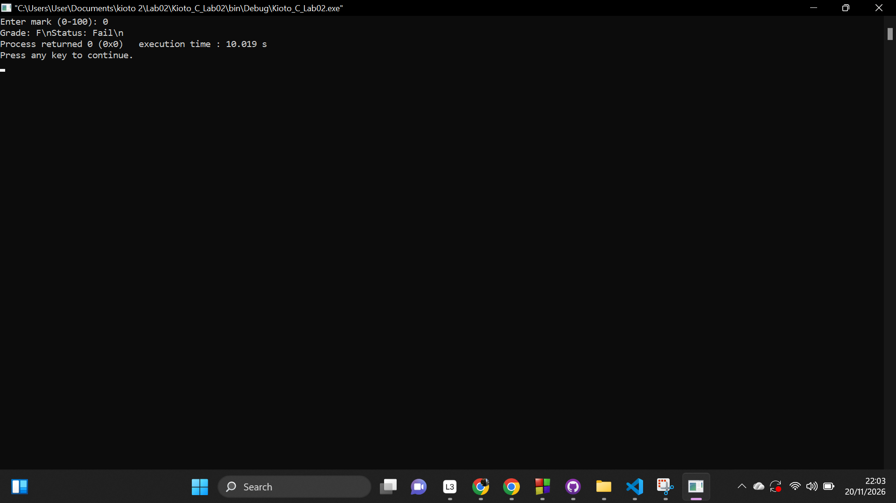
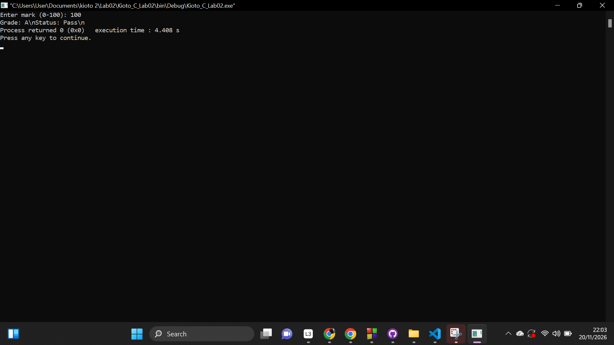
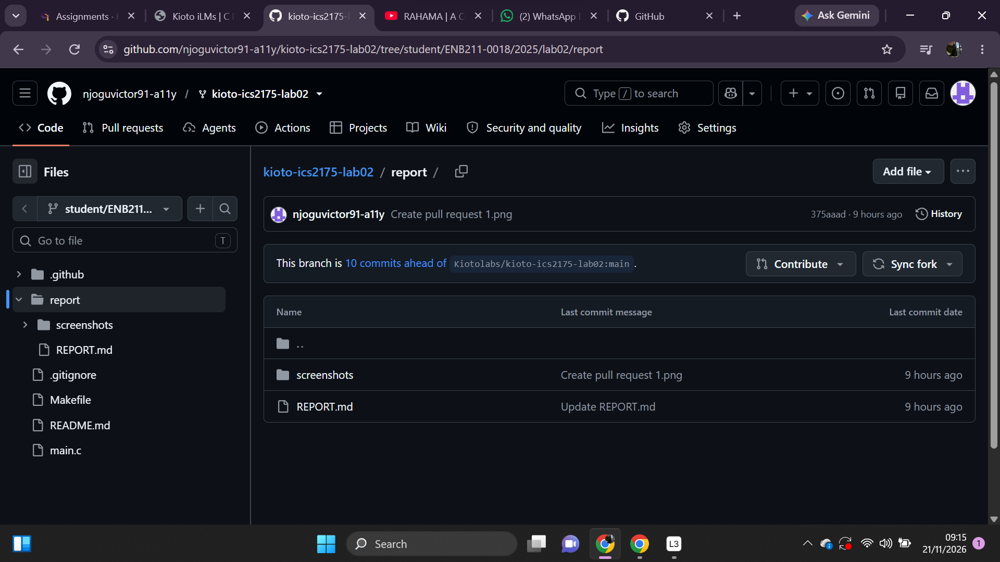

# ICS 2175: Introduction to Computer Programming
## Laboratory 02 — Selection and Decision-Making

- **Student Name:** Victor Njogu Mucheke
- **Registration Number:** ENB211-0018/2025
- **Programme:** Bachelor of Science in Agricultural and Biosystems Engineering
- **Institution:** Jomo Kenyatta University of Agriculture and Technology (JKUAT)
- **Unit Code & Title:** ICS 2175 — Introduction to Computer Programming
- **Laboratory Number:** Laboratory 02
- **Date Performed:** November 20, 2026
- **GitHub Username:** `njoguvictor91-a11y`
- **Fork Repository URL:** https://github.com/njoguvictor91-a11y/kioto-ics2175-lab02
- **Pull Request URL:** https://github.com/Kiotolabs/kioto-ics2175-lab02/pull/7

## 2. Objective

The objective of this laboratory practical was to design, implement, and test a C program that applies decision-making and selection structures to classify student numerical marks into letter grades (`A`, `B`, `C`, `D`, `F`) and determine `Pass` or `Fail` status. Specifically, this practical aimed to:
- Apply relational operators (`>=`, `<=`, `>`, `<`, `==`, `!=`) and logical operators (`&&`, `||`, `!`) to construct conditional expressions.
- Implement `if`, `if-else`, and `else-if` ladders to evaluate multi-range numeric thresholds accurately.
- Understand multi-way branching using `switch` statements alongside conditional ladders.
- Test program behavior across standard inputs and critical boundary values (`0`, `49`, `50`, `59`, `60`, `69`, `70`, `79`, `80`, `100`).
- Use Git, GitHub Desktop, and GitHub to fork a starter repository, commit changes on an individual feature branch, and submit a pull request for automated validation and review.

## 3. Environment and Setup

- **Operating System:** Windows 11 Pro (64-bit)
- **Integrated Development Environment (IDE):** Code::Blocks 25.03
- **Compiler / Toolchain:** MinGW GCC (`gcc` C compiler)
- **Version Control & Collaboration Tools:** Git, GitHub Desktop, and GitHub (`github.com`)

## 4. Exercise — Selection

### 4.1 Final Source Code (`main.c`)

```c
#include <stdio.h>

int main(void)
{
    int mark;

    printf("Enter mark (0-100): ");
    scanf("%d", &mark);

    if (mark >= 80) {
        printf("Grade: A\\n");
    } else if (mark >= 70) {
        printf("Grade: B\\n");
    } else if (mark >= 60) {
        printf("Grade: C\\n");
    } else if (mark >= 50) {
        printf("Grade: D\\n");
    } else {
        printf("Grade: F\\n");
    }

    if (mark >= 50) {
        printf("Status: Pass\\n");
    } else {
        printf("Status: Fail\\n");
    }

    return 0;
}

###4.2 Explanation of Key Statements
Header and Variable Declaration (#include <stdio.h>, int mark;):

#include <stdio.h> imports the Standard Input/Output library required for printf() and scanf().

int mark; declares an integer variable to store the student's numerical score entered from the keyboard.

User Input (printf and scanf):

printf("Enter mark (0-100): "); prompts the user for a score.

scanf("%d", &mark); reads an integer from standard input and stores it at the memory address of mark (&mark).

Grade Classification (if / else if / else Ladder):

Conditions are evaluated sequentially from highest to lowest (>= 80, >= 70, >= 60, >= 50).

Because each condition relies on short-circuiting from previous false conditions, else if (mark >= 70) is only reached when mark is strictly less than 80 (i.e., 70–79), avoiding redundant range checks.

If all if and else if checks evaluate to false (any score below 50), the final else block executes and assigns Grade: F.

Pass/Fail Determination (if-else Statement):

A second independent if (mark >= 50) check evaluates whether the student passed (>= 50, covering grades A through D) or failed (< 50, grade F).

Program Exit (return 0;):

Signals to the operating system that main() completed execution without errors.

###4.3 Sample Program Outputs
Test Case 1 — Distinction (85)

Enter mark (0-100): 85
Grade: A
Status: Pass

Test Case 2 — Upper Credit (72)

Enter mark (0-100): 72
Grade: B
Status: Pass

Test Case 3 — Pass Threshold Boundary (50)

Enter mark (0-100): 50
Grade: D
Status: Pass

Test Case 4 — Fail (40)

Enter mark (0-100): 40
Grade: F
Status: Fail

## 5. Testing and Troubleshooting

### 5.1 Controlled Test Plan and Boundary Results

To verify that all relational comparisons (`>=`) and branch transitions executed accurately, the compiled binary was tested against both standard inputs and every lower/upper boundary value across the `0–100` grading scale:

| Test Case | Input (`mark`) | Category | Expected Grade | Expected Status | Observed Output | Result |
| :--- | :--- | :--- | :--- | :--- | :--- | :--- |
| 1 | `0` | Lower bound | `F` | `Fail` | `Grade: F`, `Status: Fail` | Pass |
| 2 | `40` | Standard fail | `F` | `Fail` | `Grade: F`, `Status: Fail` | Pass |
| 3 | `49` | Upper F boundary | `F` | `Fail` | `Grade: F`, `Status: Fail` | Pass |
| 4 | `50` | Lower D / Pass boundary | `D` | `Pass` | `Grade: D`, `Status: Pass` | Pass |
| 5 | `59` | Upper D boundary | `D` | `Pass` | `Grade: D`, `Status: Pass` | Pass |
| 6 | `60` | Lower C boundary | `C` | `Pass` | `Grade: C`, `Status: Pass` | Pass |
| 7 | `69` | Upper C boundary | `C` | `Pass` | `Grade: C`, `Status: Pass` | Pass |
| 8 | `70` | Lower B boundary | `B` | `Pass` | `Grade: B`, `Status: Pass` | Pass |
| 9 | `72` | Standard B | `B` | `Pass` | `Grade: B`, `Status: Pass` | Pass |
| 10 | `79` | Upper B boundary | `B` | `Pass` | `Grade: B`, `Status: Pass` | Pass |
| 11 | `80` | Lower A boundary | `A` | `Pass` | `Grade: A`, `Status: Pass` | Pass |
| 12 | `85` | Standard A | `A` | `Pass` | `Grade: A`, `Status: Pass` | Pass |
| 13 | `100` | Upper bound | `A` | `Pass` | `Grade: A`, `Status: Pass` | Pass |

### 5.2 Troubleshooting & Observations

- **Boundary Operator Verification (`>=` vs `>`):** During initial testing of boundary scores (`50`, `60`, `70`, `80`), using strict greater-than (`>`) would misclassify exact threshold marks into the lower grade bracket (e.g., classifying `80` as `B` instead of `A`). Confirming inclusive relational operators (`>=`) resolved all boundary transitions cleanly.
- **Escape Sequence Formatting (`\n`):** When copying and formatting `printf` strings, double-escaped newline literals (`\\n`) print a literal `\n` instead of moving the console cursor to a new line. Ensuring single newline escape sequences (`\n`) in the compiled source file produced clean two-line output (`Grade` followed by `Status` on the next line).
- **Out-of-Range Input Limitation:** Testing values outside `0–100` (such as `-5` or `105`) demonstrated that without explicit range validation (`mark < 0 || mark > 100`), the `else-if` ladder classifies `105` as `Grade: A` and `-5` as `Grade: F`, highlighting the importance of input validation guards before grading logic runs.

## 6. GitHub Workflow

- **Upstream Starter Repository:** https://github.com/Kiotolabs/kioto-ics2175-lab02
- **Personal Fork URL:** https://github.com/njoguvictor91-a11y/kioto-ics2175-lab02
- **Working Branch:** `student/ENB211-0018/2025/lab02`
- **Pull Request URL:** https://github.com/Kiotolabs/kioto-ics2175-lab02/pull/7

### Commit Summary
1. Forked `Kiotolabs/kioto-ics2175-lab02` to `njoguvictor91-a11y/kioto-ics2175-lab02` and cloned locally via GitHub Desktop.
2. Created individual feature branch `student/ENB211-0018/2025/lab02`.
3. Implemented and tested the mark classification and pass/fail selection logic in `main.c`.
4. Completed the individual technical report and pushed commits to origin before opening Pull Request `#7` targeting `Kiotolabs:main`.

## 7. Reflection

- **What I Learned:** I learned how sequential `else-if` ladders evaluate mutually exclusive numeric ranges cleanly from top to bottom without duplicating upper-bound comparisons, and how relational operators (`>=`) govern exact boundary behavior. On the version-control side, I reinforced the standard open-source and classroom Git workflow: forking an upstream repository, isolating work on a dedicated student branch (`student/ENB211-0018/2025/lab02`), and opening a pull request back to `Kiotolabs:main`.
- **What Was Difficult:** Ensuring exact alignment between the branch naming convention, PR target direction (`Kiotolabs:main` vs. my fork's (`main`), and boundary test cases required careful attention so that automated repository checks and grading thresholds matched the specification.
- **What I Would Do Differently:** In future practicals, I would add an explicit input validation guard (`if (mark < 0 || mark > 100)`) before the grading ladder so invalid or out-of-range inputs are rejected with an informative message rather than falling through to `Grade: A` or `Grade: F`, and I would avoid spaces or `=` characters in screenshot filenames (using hyphens/underscores instead) for cleaner cross-platform Markdown linking.

## 8. Conclusion

All objectives of Laboratory 02 were successfully achieved. The C program compiled in Code::Blocks without warnings, accurately classified student marks into letter grades (`A`–`F`) and `Pass`/`Fail` status across both standard and boundary inputs, and was properly version-controlled and submitted via Pull Request `#7` (`https://github.com/Kiotolabs/kioto-ics2175-lab02/pull/7`) from my personal fork.

## 9. Evidence

### 9.1 Code::Blocks Project and Source Code


### 9.2 Program Execution Outputs (Standard and Boundary Test Cases)
- **Lower Boundary (`mark = 0` — Grade: F, Status: Fail):**
  

- **Standard Fail (`mark = 40` — Grade: F, Status: Fail):**
  

- **Pass Boundary (`mark = 50` — Grade: D, Status: Pass):**
  

- **Standard Credit (`mark = 72` — Grade: B, Status: Pass):**
  

- **Distinction Boundary (`mark = 80` — Grade: A, Status: Pass):**
  

- **Standard Distinction (`mark = 85` — Grade: A, Status: Pass):**
  

- **Upper Boundary (`mark = 100` — Grade: A, Status: Pass):**
  

### 9.3 GitHub Repository and Pull Request
- **Forked Repository Files (`njoguvictor91-a11y/kioto-ics2175-lab02`):**
  

- **Pull Request `#7` (`https://github.com/Kiotolabs/kioto-ics2175-lab02/pull/7`):**
  