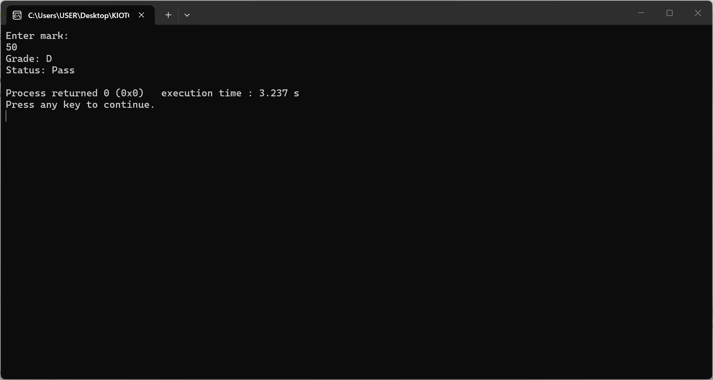
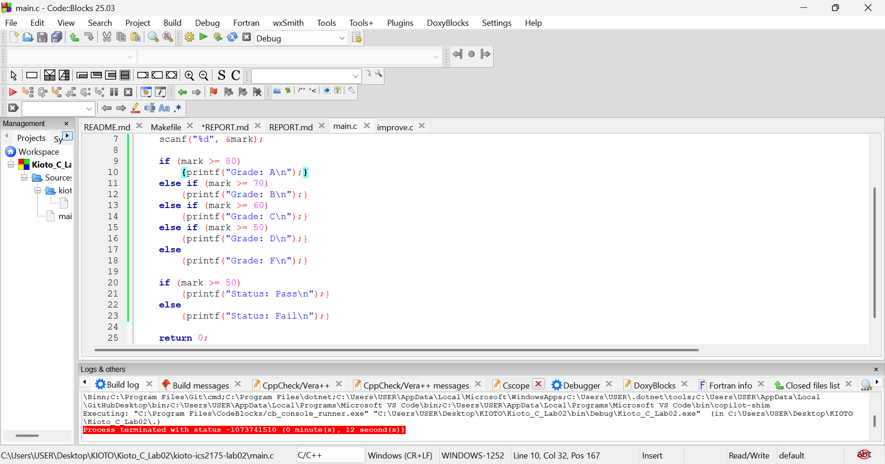
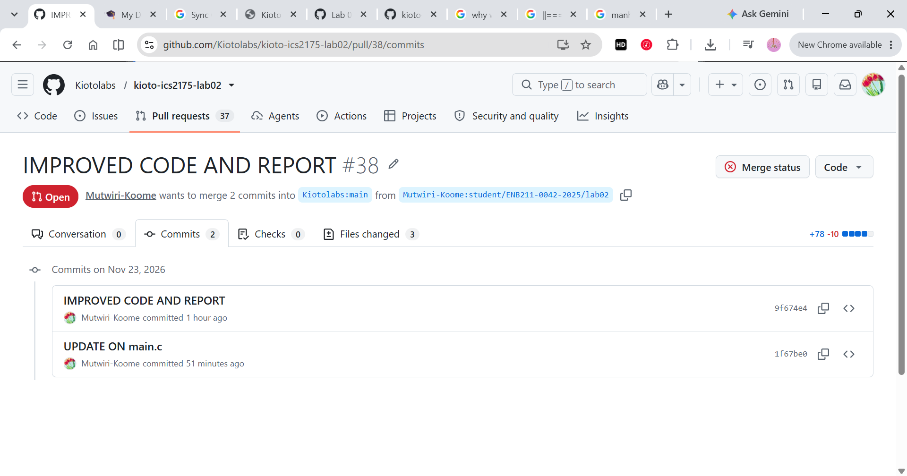
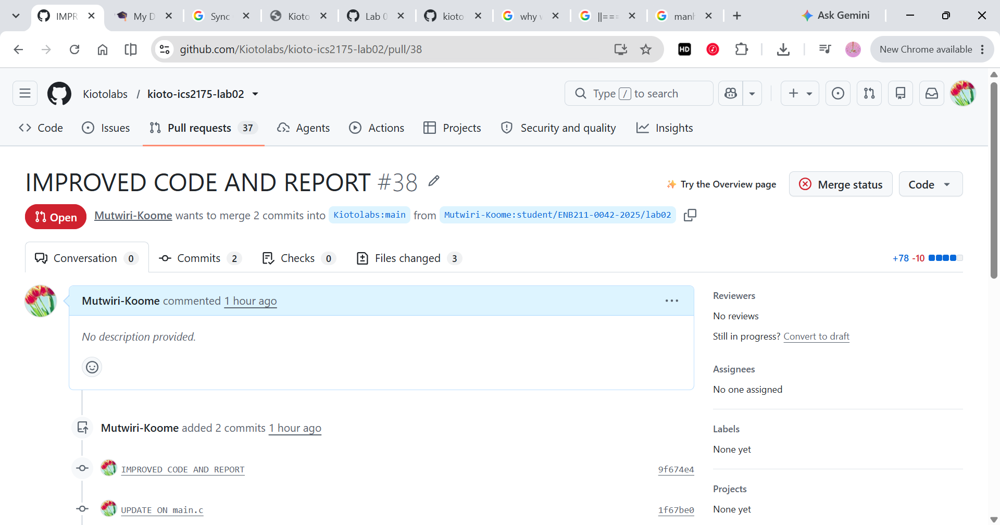

# ICS 2175 – Laboratory 02 Report

## 1. Cover Information

- **Student Full Name:** Victor Koome Mutwiri
- **Registration Number:** ENB211-0042/2025
- **Programme:** Bsc. Agriculture and Biosystems Engineering
- **GitHub Username:** @Mutwiri-Koome
- **Lab Topic:** Control Structures – Conditional Statements (`if`, `else if`, `else`)
- **Date:** 23/11/2026

## 2. Objectives

- To understand and implement conditional decision-making in C using `if`, `else if`, and `else` statements.
- To write a C program (`main.c`) that evaluates a student's numerical mark, assigns a corresponding letter grade, and determines pass/fail status.
- To identify edge cases and improve program robustness (`improve.c`) through input validation and proper formatting.
- To manage multiple C source files in a Code::Blocks project and submit the completed work using Git and GitHub Desktop.

## 3. Software and Hardware Environment

- **Operating System:** Windows 11
- **IDE:** Code::Blocks 25.03
- **Compiler:** GNU GCC Compiler
- **Hardware:** HP Zbook i7, 32GB RAM

## 4. Initial Implementation (`main.c`)

### Program Description
The initial program (`main.c`) prompts the user to enter an integer mark and evaluates it using two conditional blocks:
1. An `if / else if / else` ladder that checks the mark from highest to lowest (`>= 80` for A, `>= 70` for B, `>= 60` for C, `>= 50` for D, and `< 50` for F).
2. A separate `if / else` statement that checks whether `mark >= 50` to output either `Status: Pass` or `Status: Fail`.

### Code Snippet (`main.c`)
```c
#include <stdio.h>
#include <stdlib.h>

int main() {
    int mark;
    printf("Enter mark: \n");
    scanf("%d", &mark);

    if (mark >= 80) {
        printf("Grade: A\n");
    } else if (mark >= 70) {
        printf("Grade: B\n");
    } else if (mark >= 60) {
        printf("Grade: C\n");
    } else if (mark >= 50) {
        printf("Grade: D\n");
    } else {
        printf("Grade: F\n");
    }

    if (mark >= 50) {
        printf("Status: Pass\n");
    } else {
        printf("Status: Fail\n");
    }

    return 0;
}
```

### Sample Output (`main.c`)


## 5. Improved Implementation (`improve.c`)

### Limitations of `main.c` & Enhancements Made
While `main.c` compiles and executes valid inputs accurately, testing revealed several edge-case limitations that were resolved in `improve.c`:
- **Out-of-Range Validation:** `main.c` accepted invalid marks such as negative numbers (e.g., `-20`) or numbers above `100` (e.g., `150`). `improve.c` restricts valid inputs to the `0–100` range.
- **Non-Numeric Input Handling:** Entering letters or symbols caused `scanf()` to fail without warning, leaving `mark` uninitialized. `improve.c` checks `scanf("%d", &mark) != 1` to catch non-integer inputs safely.
- **Header Cleanup & Formatting:** Removed the unused `#include <stdlib.h>` directive and structured the code with clean indentation for readability.

### Code Snippet (`improve.c`)
```c
#include <stdio.h>

int main() {
    int mark;
    printf("Enter mark (0-100): ");

    // Validate that input is an integer within the 0-100 range
    if (scanf("%d", &mark) != 1 || mark < 0 || mark > 100) {
        printf("Invalid input. Please enter a number between 0 and 100.\n");
        return 1;
    }

    if (mark >= 80) {
        printf("Grade: A\n");
    } else if (mark >= 70) {
        printf("Grade: B\n");
    } else if (mark >= 60) {
        printf("Grade: C\n");
    } else if (mark >= 50) {
        printf("Grade: D\n");
    } else {
        printf("Grade: F\n");
    }

    if (mark >= 50) {
        printf("Status: Pass\n");
    } else {
        printf("Status: Fail\n");
    }

    return 0;
}
```

### Sample Output (`improve.c`)


## 6. Explanation of Conditional Logic Used

- **`if / else if / else` Chain:** Evaluates mutually exclusive grade thresholds sequentially from top to bottom. Once a condition evaluates to true, its block runs and the remaining branches are skipped.
- **Relational & Logical Operators:** Uses `>=` for grade boundaries, and `||` (logical OR) alongside `<` and `>` in `improve.c` to reject out-of-bounds inputs.
- **Independent `if / else` Block:** Separates pass/fail determination (`mark >= 50`) from letter grading so both pieces of feedback are displayed clearly.

## 7. Testing and Troubleshooting

### Test Cases

| Test Case | Input | Expected Output (`main.c`) | Expected Output (`improve.c`) |
| :--- | :--- | :--- | :--- |
| Distinction | `85` | `Grade: A`, `Status: Pass` | `Grade: A`, `Status: Pass` |
| Pass Boundary | `50` | `Grade: D`, `Status: Pass` | `Grade: D`, `Status: Pass` |
| Fail | `42` | `Grade: F`, `Status: Fail` | `Grade: F`, `Status: Fail` |
| Out of Range | `120` | `Grade: A`, `Status: Pass` (Bug) | `Invalid input...` |
| Non-Numeric | `abc` | Unpredictable / Garbage value | `Invalid input...` |

### Compilation Errors Encountered & Resolved
- **Error:** `multiple definition of 'main'; ld returned 1 exit status`
- **Cause:** Both `main.c` and `improve.c` resided in the same Code::Blocks project (`Kioto_C_Lab02`) and each contained a `main()` entry point.
- **Resolution:** Excluded one source file from the active build at a time via **Properties > Build** (unchecking *Compile file* and *Link file*) so only one `main()` function was compiled and linked per build.

## 8. GitHub Workflow

1. **Fork & Clone:** Forked the `kioto-ics2175-lab02` repository on GitHub and cloned it locally using GitHub Desktop: [Mutwiri-Koome/kioto-ics2175-lab02](https://github.com).
2. **Branch & File Organization:** Worked on the student branch (`student/ENB211-0042-2025/lab02`) and placed both `main.c` and `improve.c` inside the local repository directory.
3. **Commit & Push:** Staged the source files and report assets in GitHub Desktop, created descriptive commit messages, and pushed the changes to the remote `origin` repository.
4. **Pull Request:** Opened Pull Request #38 to merge the completed work into the upstream repository: [Pull Request #38](https://github.com).

## 9. Screenshots

### 9.1 Code::Blocks Project Setup
- **Figure 1:** Code::Blocks showing the `Kioto_C_Lab02` project tree and source files (`main.c` and `improve.c`) open in the editor.



### 9.2 Program Execution & Test Cases
- **Figure 2:** Console output demonstrating test cases across `main.c` and `improve.c` (passing grade, failing grade, and invalid/boundary input).


### 9.3 GitHub Repository
- **Figure 3:** Forked GitHub repository showing the committed files.



### 9.4 Pull Request Submission
- **Figure 4:** Submitted Pull Request (#38) on GitHub.



- **Pull Request Link:** https://github.com

## 10. Individual Reflection

Through this laboratory, I gained practical experience in structuring decision-making logic in C using `if`, `else if`, and `else` chains. Comparing `main.c` with `improve.c` highlighted the importance of defensive programming—specifically validating `scanf()` return values and enforcing `0–100` bounds so unexpected inputs do not produce misleading grades.

The main technical challenge I encountered was the `multiple definition of 'main'` linker error when keeping both `main.c` and `improve.c` inside the same Code::Blocks project. Learning how to exclude inactive source files from the build target—as well as organizing files correctly inside the local repository folder for GitHub Desktop—gave me a much clearer understanding of how C compilation and Git version control workflows operate together.

## 11. Conclusion

In this laboratory, a C grading and pass/fail evaluation program was successfully implemented in `main.c` and enhanced with input validation in `improve.c`. Troubleshooting linker errors in Code::Blocks reinforced how C projects compile single entry points, while GitHub Desktop facilitated version control and submission of both source files.
