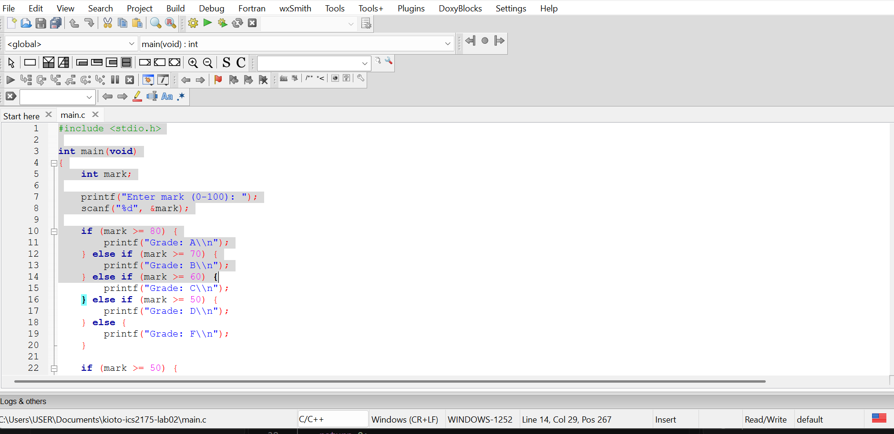
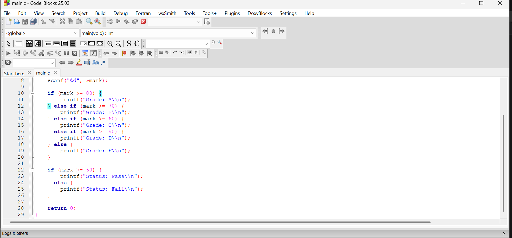
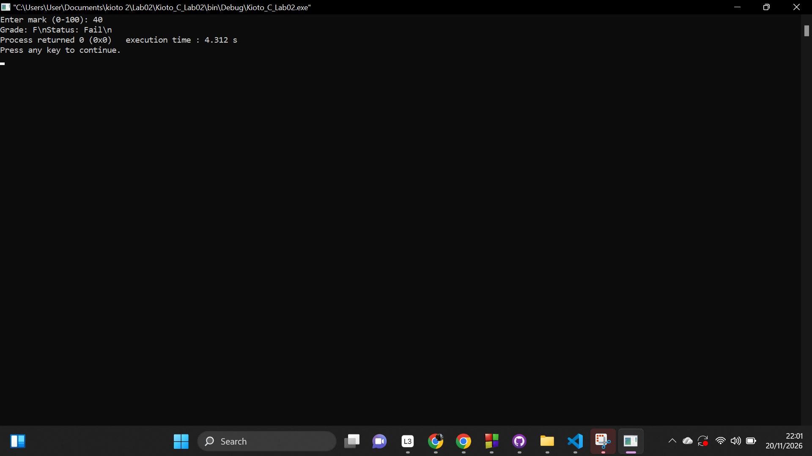
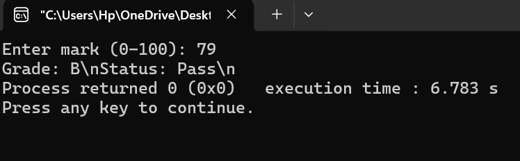
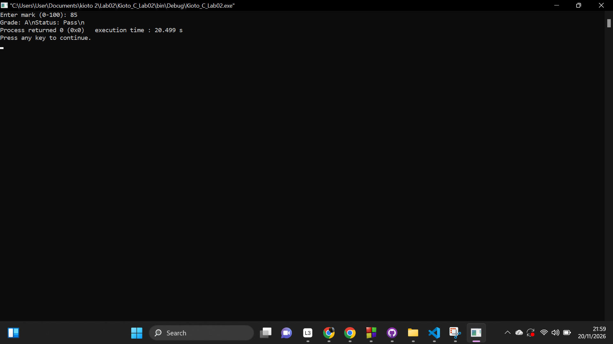

# ICS 2175 – Introduction to Computer Programming

## Laboratory 02: Selection and Decision-Making

**Student Name:** Anne Favour Ouma

**Registration Number:** ENB211-0017/2025

**Programme:** Bachelor of Science in Agricultural Biosystems Engineering

**Institution:** Jomo Kenyatta University of Agriculture and Technology (JKUAT)

**Date Performed:** 21 November 2026

**GitHub Username:** beingfav

## 1. Objective

The main objective of this laboratory exercise was to understand and apply selection and decision-making statements in the C programming language.

The specific objectives were:

1. To understand and use relational and logical operators in C.
2. To implement `if`, `if-else`, and `else-if` statements.
3. To use conditional statements to classify marks into grades.
4. To determine whether a student has passed or failed based on their marks.
5. To test a C program using different input values, including boundary values.
6. To practise using Git and GitHub to manage and submit programming work.

## 2. Environment and Setup

The laboratory exercise was carried out using a Windows computer. The following tools were used:

| Component | Description |
|---|---|
| Operating System | Windows |
| Programming Language | C |
| IDE | Code::Blocks |
| Compiler | GCC 14.2.0 (MinGW) |
| Version Control | Git |
| Online Repository | GitHub |

### Setup Procedure

1. Code::Blocks was used to open and edit the C source code.
2. The GCC compiler was used to compile the program.
3. The source files were saved in the Laboratory 02 project folder.
4. GitHub Desktop was used to manage the repository and version control.
5. Screenshots were saved in the `report/screenshots/` directory as evidence of the practical work.

## 3. Exercise: Selection and Decision-Making

### 3.1 Description

In this exercise, I developed a C program that accepts a student's mark and uses conditional statements to determine the corresponding grade and pass/fail status.

The grading scale used was:

| Mark Range | Grade | Status |
|---|---|---|
| 80–100 | A | Pass |
| 70–79 | B | Pass |
| 60–69 | C | Pass |
| 50–59 | D | Pass |
| 0–49 | F | Fail |

### 3.2 Source Code

The program uses `if`, `else if`, and `else` statements to classify the student's mark.
#include <stdio.h>

int main(void)
{
    int mark;

    printf("Enter mark (0-100): ");
    scanf("%d", &mark);

    if (mark >= 80) {
        printf("Grade: A\\n");
    } else if (mark >= 70) {
        printf("Grade: B\\n");
    } else if (mark >= 60) {
        printf("Grade: C\\n");
    } else if (mark >= 50) {
        printf("Grade: D\\n");
    } else {
        printf("Grade: F\\n");
    }

    if (mark >= 50) {
        printf("Status: Pass\\n");
    } else {
        printf("Status: Fail\\n");
    }

    return 0;
}

### 3.3 Explanation of the Program

The program prompts the user to enter a mark between 0 and 100.

The `if-else-if` statements compare the entered mark against the grading ranges. Depending on the value entered, the program assigns grade A, B, C, D or F.

A separate `if-else` statement determines the student's performance status. A mark of 50 or above results in a Pass, while a mark below 50 results in a Fail.

Relational operators such as `>=` are used to compare the mark with the grading thresholds.

## 4. Testing and Results

The program was tested using different marks to check whether the grading conditions produced the correct results.

### 4.1 Test Cases

| Input Mark | Expected Grade | Expected Status |
|---:|---|---|
| 85 | A | Pass |
| 72 | B | Pass |
| 40 | F | Fail |
| 50 | D | Pass |
| 80 | A | Pass |
| 0 | F | Fail |
| 100 | A | Pass |
| 79 | B | Pass |

### 4.2 Observations

The tests demonstrated that the program could classify marks according to the specified grading scale.

Marks of 50 and above were classified as Pass, while marks below 50 were classified as Fail. The boundary values helped confirm that the conditions were working as intended.

## 5. Testing and Troubleshooting

During the practical exercise, I tested the program using different marks to verify that the conditional statements worked correctly.

### 5.1 Testing

I tested the program using marks from different grading ranges, including 85, 72, 40 and 50. This helped me confirm that the program assigned the correct grades and pass/fail statuses.

### 5.2 Troubleshooting

One important part of testing was checking the boundary values of the grading scale. For example, a mark of 49 should result in Grade F and Fail, while a mark of 50 should result in Grade D and Pass.

This helped me understand the importance of using the correct relational operators and conditions when classifying values.

### 5.3 Outcome

The testing process helped me understand how conditional statements control the execution of a C program and how different inputs produce different outputs.

## 6. GitHub Workflow

Git and GitHub were used to manage and submit the Laboratory 02 project.

The workflow involved the following steps:

1. Forking the official Kiotolabs Laboratory 02 repository into my GitHub account.
2. Cloning my fork to my local computer using GitHub Desktop.
3. Creating an individual branch for the laboratory exercise.
4. Editing and saving the C source code and report.
5. Committing the changes to record the progress made.
6. Pushing the branch to my GitHub repository.
7. Creating a pull request to the original Kiotolabs repository for review.

### 6.1 Repository Details

- **Official repository:** https://github.com/Kiotolabs/kioto-ics2175-lab02
- **Personal GitHub username:** beingfav
- **Personal fork URL:** TO BE ADDED
- **Branch name:** student/ENB211-0017/2025/lab02
- **Pull request URL:** TO BE ADDED

The pull request was intended for the original Kiotolabs repository so that the lecturer could review the submitted work.

## 7. Individual Reflection

This laboratory exercise helped me improve my understanding of selection and decision-making in the C programming language.

I learned how to use relational operators and conditional statements such as `if`, `if-else` and `else-if` to make decisions based on user input.

I also learned the importance of testing programs with different values, especially boundary values, to ensure that the conditions produce correct results.

One challenge was understanding how to arrange the conditions correctly so that each mark falls into the appropriate grading range.

Overall, the practical improved my problem-solving skills and gave me more confidence in writing C programs that make decisions.

## 8. Conclusion

The laboratory exercise successfully introduced me to selection and decision-making in C programming. I practised using relational operators and if-else-if statements to classify student marks into grades and determine pass or fail status.

I also gained experience in testing program outputs and using GitHub to manage programming work. The exercise improved my understanding of conditional statements and their application in solving programming problems.

## 9. Screenshot Evidence

### 9.1 Source Code in Code::Blocks

### 9.2 Second Source Code Screenshot

### 9.3 Test Case: Mark 0

### 9.4 Test Case: Mark 40

### 9.5 Test Case: Mark 50

### 9.6 Test Case: Mark 72

### 9.7 Test Case: Mark 79

### 9.8 Test Case: Mark 80

### 9.9 Test Case: Mark 85

### 9.10 Test Case: Mark 100

