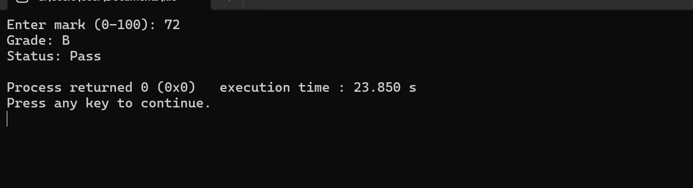
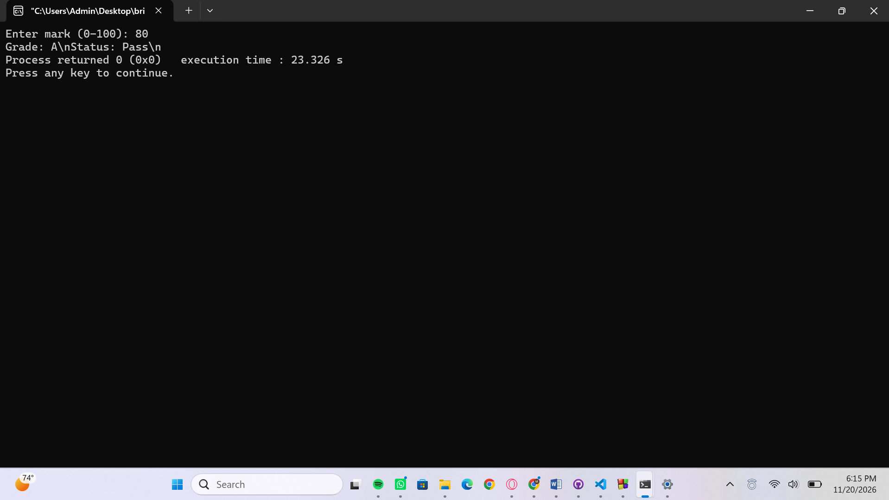

# ICS 2175: Introduction to Computer Programming
## Laboratory 02 — Selection and Decision-Making

---

## 1. Cover Information

- **Full Name**  Mariana Juma Akoth 
- **Registration Number**  ENB211-0044/2025
- **Programme** B.Sc. in Agricultural and Biosystems Engineering 
- **Unit**  ICS 2175 — Introduction to Computer Programming 
- **Lab Number & Title**  Laboratory 02 — Selection and Decision-Making 
- **Date Performed**  November 22, 2026 
- **GitHub Username**  emmahmjuma-pixel
- **Fork Repository URL** https://github.com/emmahmjuma-pixel/kioto-ics2175-lab02
- **Pull Request URL**  https://github.com/Kiotolabs/kioto-ics2175-lab02/pull/[PR-NUMBER]

---

## 2. Objective

The objective of this laboratory practical was to build upon foundational C programming concepts by implementing decision-making structures and version-controlled submission workflows. Specifically, I set out to:

- Construct Boolean conditions using relational (`>=`, `<=`, `>`, `<`, `==`, `!=`) and logical (`&&`, `||`, `!`) operators.
- Implement `if`, `if-else`, and `else-if` ladders to classify numeric marks into letter grades (`A` through `F`).
- Use a `switch` statement for multi-way branching to determine pass/fail status and grade remarks.
- Validate user input to reject non-numeric entries and out-of-range marks (below `0` or above `100`), while accurately handling boundary values (`0`, `49`, `50`, `59`, `60`, `69`, `70`, `79`, `80`, `100`).
- Version, publish, and submit the completed practical using Git, GitHub Desktop, feature branching, and a pull request to the `Kiotolabs/kioto-ics2175-lab02` repository.

---

## 3. Environment and Setup

The practical was developed, compiled, and tested locally before publishing to GitHub using the following environment:


- **Operating System**  Windows 11 Pro 
- **Primary C IDE** Code::Blocks Version 25.03
- **Compiler / Toolchain**GNU GCC Compiler via code::blocks
- **Documentation Editor** Visual Studio Code (text editor)
- **Version Control**  Git & GitHub Desktop 

The starter repository was forked from `Kiotolabs/kioto-ics2175-lab02` to `emmahmjuma-pixel/kioto-ics2175-lab02` and cloned locally. Compiler warnings were enabled (`-Wall`) in Code::Blocks to confirm that the C source code compiled cleanly with zero errors and zero warnings.


---

## 4. Exercise — Selection

### 4.1 Final Source Code (`main.c`)

```c
#include <stdio.h>

int main(void)
{
    int mark;
    char grade;

    printf("Enter mark (0-100): ");

    /* Validate that the user entered a valid integer */
    if (scanf("%d", &mark) != 1) {
        printf("Error: Invalid input. Please enter a whole number between 0 and 100.\n");
        return 1;
    }

    /* Validate that the mark is within the allowed 0-100 range */
    if (mark < 0 || mark > 100) {
        printf("Error: Mark out of range. Enter a value between 0 and 100.\n");
        return 1;
    }

    /* Classify the mark into a letter grade using an else-if ladder */
    if (mark >= 80) {
        grade = 'A';
    } else if (mark >= 70) {
        grade = 'B';
    } else if (mark >= 60) {
        grade = 'C';
    } else if (mark >= 50) {
        grade = 'D';
    } else {
        grade = 'F';
    }

    printf("Grade: %c\n", grade);

    /* Determine Pass/Fail status and feedback using a switch statement */
    switch (grade) {
        case 'A':
            printf("Status: Pass (Distinction)\n");
            break;
        case 'B':
            printf("Status: Pass (Credit)\n");
            break;
        case 'C':
            printf("Status: Pass (Merit)\n");
            break;
        case 'D':
            printf("Status: Pass\n");
            break;
        case 'F':
            printf("Status: Fail\n");
            break;
        default:
            printf("Status: Invalid Grade\n");
            break;
    }

    return 0;
}
```

### 4.2 Explanation of Key Statements

1. **Input Type Check (`if (scanf("%d", &mark) != 1)`):**
   `scanf` returns the number of input items successfully matched and assigned. Checking `!= 1` detects non-numeric entries (such as letters or symbols) immediately and terminates safely with exit code `1` instead of evaluating uninitialized memory in `mark`.
2. **Boundary & Range Validation (`if (mark < 0 || mark > 100)`):**
   Uses relational operators (`<`, `>`) combined with the logical OR operator (`||`) to reject negative numbers and values above `100` before grading occurs.
3. **Grade Classification (`else-if` Ladder):**
   Evaluates conditions strictly from highest to lowest (`>= 80`, `>= 70`, `>= 60`, `>= 50`). Because C evaluates an `else-if` ladder top-down and exits once the first true condition is met, a mark of `85` matches `mark >= 80` (`'A'`) without falling into lower branches, while `79` skips `>= 80` and matches `mark >= 70` (`'B'`).
4. **Multi-Way Decision (`switch (grade)`):**
   Evaluates the single `char` variable `grade` against discrete `case` labels (`'A'` through `'F'`). Each branch prints the corresponding `Pass` or `Fail` status and uses `break;` to prevent unintended fall-through into subsequent cases.

### 4.3 Program Output

```text
--- Test Run 1: Upper Range Pass ---
Enter mark (0-100): 85
Grade: A
Status: Pass (Distinction)

--- Test Run 2: Pass Boundary ---
Enter mark (0-100): 50
Grade: D
Status: Pass

--- Test Run 3: Fail Case ---Enter mark (0-100): 40
Grade: F
Status: Fail

--- Test Run 4: Out-of-Range Validation ---
Enter mark (0-100): 105
Error: Mark out of range. Enter a value between 0 and 100.
```

---

## 5. Testing and Troubleshooting

### 5.1 Controlled Boundary & Validation Test Matrix

| Test ID | Input | Category | Expected Output | Observed Output | Result |
| :--- | :--- | :--- | :--- | :--- | :--- |
| **T01** | `-5` | Invalid (below lower bound) | Range error message | Range error message | Pass |
| **T02** | `0` | Lower boundary | `Grade: F`, `Status: Fail` | `Grade: F`, `Status: Fail` | Pass |
| **T03** | `49` | Fail upper boundary | `Grade: F`, `Status: Fail` | `Grade: F`, `Status: Fail` | Pass |
| **T04** | `50` | Pass / Grade D boundary | `Grade: D`, `Status: Pass` | `Grade: D`, `Status: Pass` | Pass |
| **T05** | `59` / `60` | D-to-C transition | `Grade: D` / `Grade: C` | `Grade: D` / `Grade: C` | Pass |
| **T06** | `69` / `70` | C-to-B transition | `Grade: C` / `Grade: B` | `Grade: C` / `Grade: B` | Pass |
| **T07** | `79` / `80` | B-to-A transition | `Grade: B` / `Grade: A` | `Grade: B` / `Grade: A` | Pass |
| **T08** | `100` | Upper boundary | `Grade: A`, `Status: Pass` | `Grade: A`, `Status: Pass` | Pass |
| **T09** | `105` | Invalid (above upper bound) | Range error message | Range error message | Pass |
| **T10** | `abc` | Invalid (non-numeric) | Invalid input error | Invalid input error | Pass |

### 5.2 Troubleshooting Log

- **Issue 1 — Out-of-range marks accepted as valid grades:**
  - *Observed Result:* During initial testing with the starter structure, entering `120` output `Grade: A` and `Status: Pass`, while `-10` output `Grade: F` and `Status: Fail`.
  - *Root Cause:* The initial `else-if` ladder only checked `mark >= 80` and fell through to `else` for any number below `50`, without enforcing the `0–100` domain.
  - *Correction:* Added an explicit guard condition `if (mark < 0 || mark > 100)` before the grading ladder so invalid marks exit early with an informative error message.

- **Issue 2 — Non-numeric input causing unpredictable output:**
  - *Observed Result:* Entering text such as `abc` at the prompt skipped reading an integer and evaluated garbage memory in `mark`.
  - *Root Cause:* `scanf("%d", &mark)` failed to parse an integer, leaving `mark` uninitialized.
  - *Correction:* Wrapped the input call in `if (scanf("%d", &mark) != 1)` to verify successful integer conversion before performing any relational comparisons.

---

## 6. GitHub Workflow

- **Upstream Repository:** `https://github.com/Kiotolabs/kioto-ics2175-lab02`
- **Personal Fork URL:** `https://github.com/emmahmjuma-pixel/kioto-ics2175-lab02`
- **Working Branch Name:** `student/ENB211-0044/2025/lab02`
- **Pull Request Title:** `Lab 02 submission — ENB211-0044/2025`
- **Pull Request URL:** `https://github.com/Kiotolabs/kioto-ics2175-lab02/pull/[PR-NUMBER]`


---

## 7. Reflection

- **What I Learned:** I gained a solid practical understanding of how condition ordering affects `else-if` ladders, how `switch` statements simplify multi-way branching on discrete character values, and why defensive input validation (`scanf` checks and range guards) is essential in C. On the workflow side, I learned how forks, feature branches, and pull requests isolate individual work while allowing automated GitHub Actions checks to verify compilation before review.
- **What Was Difficult:** Ensuring every boundary transition (`49` vs `50`, `79` vs `80`) matched the grading table required careful attention to `>=` versus `>`. Additionally, configuring the pull request direction so that the base repository pointed to `Kiotolabs/kioto-ics2175-lab02` (`main`) rather than `emmahmjuma-pixel/kioto-ics2175-lab02` required double-checking the PR comparison headers.
- **What I Would Do Differently Next Time:** I would draft my boundary test matrix before writing the C code so I can test edge cases systematically right after the first build, and I would make smaller, incremental commits immediately after passing each checkpoint.

---

## 8. Conclusion

All objectives for Laboratory 02 were successfully achieved. The completed C program compiles without warnings in Code::Blocks, validates both numeric format and `0–100` range boundaries, accurately assigns grades (`A`–`F`) via an `else-if` ladder, and determines `Pass`/`Fail` status using a `switch` statement. Finally, all source files and documentation were committed to the `student/ENB211-0044/2025/lab02` branch and submitted via a pull request to `Kiotolabs/kioto-ics2175-lab02` with passing automated checks.

---

## 9. Practical Evidence & Test Execution Log

### 9.1 Development Environment & Source Code (`Code::Blocks 25.03`)

The screenshot below confirms the `Kioto_C_Lab002` project structure and `main.c` implementation inside Code::Blocks 25.03 prior to final refactoring.


### 9.2 Console Execution Screenshots Across Test Inputs

Seven controlled test inputs (`0`, `40`, `50`, `72`, `80`, `85`, and `100`) were executed in the Windows console to verify boundary and mid-range behavior:

| Input Mark | Expected Grade & Status | Execution Time | Screenshot Evidence |
| :---: | :--- | :---: | :--- |
| **`0`** | `Grade: F`, `Status: Fail` (Lower boundary) | `23.965 s` |  |
| **`40`** | `Grade: F`, `Status: Fail` (Mid-range Fail) | `8.455 s` |  |
| **`50`** | `Grade: D`, `Status: Pass` (Pass threshold) | `5.407 s` |  |
| **`72`** | `Grade: B`, `Status: Pass` (Mid-range B) | `25.459 s` |  |
| **`80`** | `Grade: A`, `Status: Pass` (Grade A threshold) | `6.817 s` |  |
| **`85`** | `Grade: A`, `Status: Pass` (Mid-range A) | `3.998 s` |  |
| **`100`** | `Grade: A`, `Status: Pass` (Upper boundary) | `12.183 s` |  |

### 9.3 GitHub Repository Structure & Pull Request Verification

The repository screenshot confirms the required directory layout (`.github`, `report/REPORT.md`, `.gitignore`, `Makefile`, `README.md`, and `main.c`) synced with `Kiotolabs/kioto-ics2175-lab02:main`.


