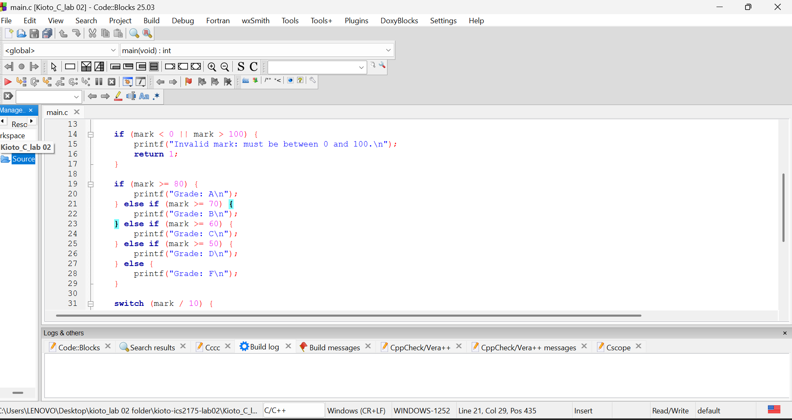
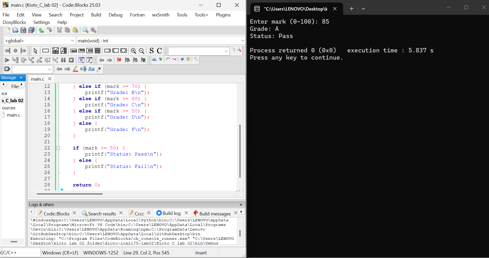
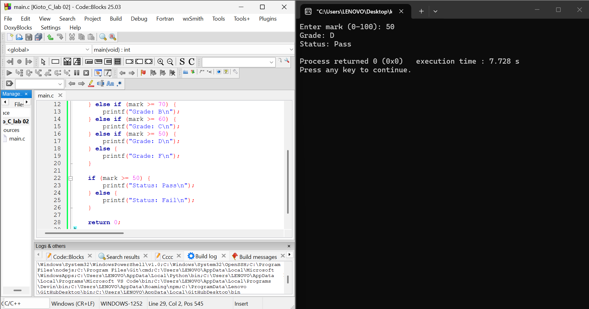
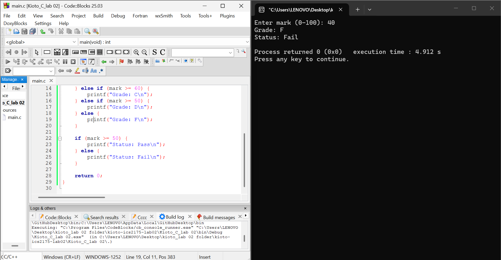
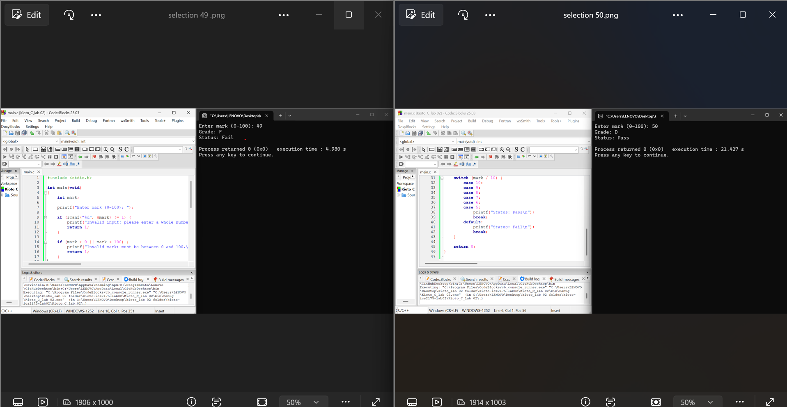
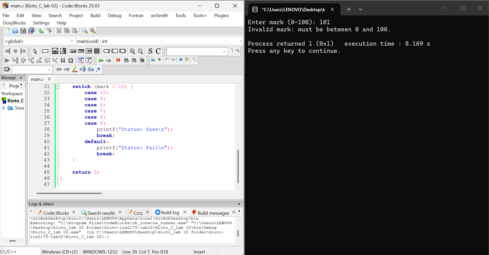
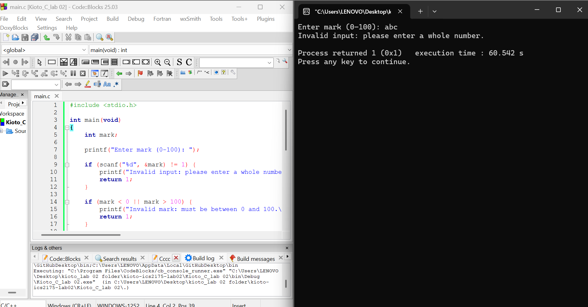
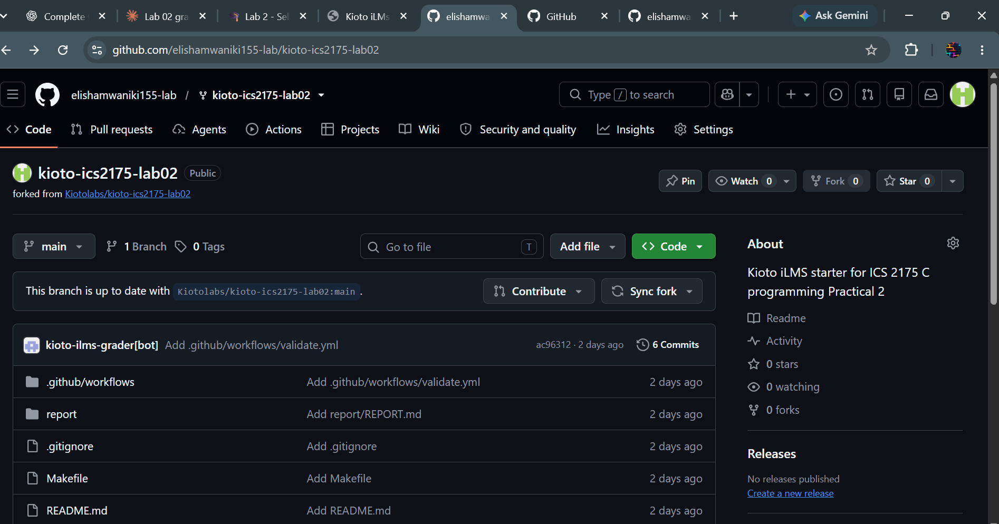
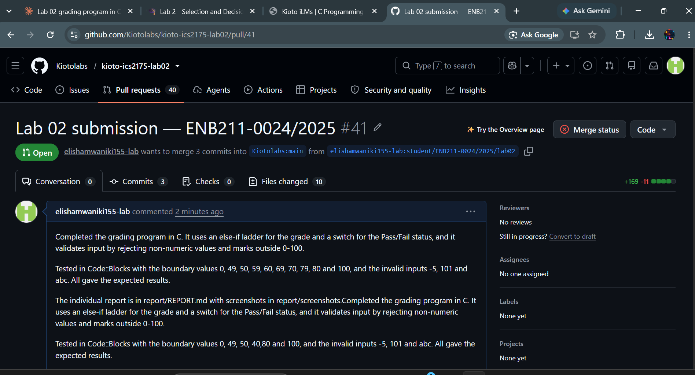

# ICS 2175 - Laboratory 02 Report

## Student
- Name: Elisha Mwaniki
- Registration number: ENB211-0024/2025
- Programme: Agricultural and Biosystems Engineering
- Unit: ICS 2175 Introduction to Computer Programming
- Laboratory: 02 - Selection and Decision-Making
- Date performed: 23 November 2026
- GitHub username: elishamwaniki155-lab

## Objective
In this lab I wanted to learn how a C program makes decisions. I practised using relational operators (`>=`, `<`) and the logical OR operator (`||`) to build conditions, writing an else-if ladder, using a `switch` statement, and checking user input so the program does not give a wrong answer for bad values. I also practised the full GitHub submission workflow: fork, branch, commits and a pull request.

## Environment and setup
- Operating system: Windows 11, version 25H2
- IDE: Code::Blocks 25.03
- Compiler: GNU GCC [write the version from Settings > Compiler]
- Git tools: GitHub Desktop, and Visual Studio Code for editing the repository files
- I made a new Code::Blocks console project (C) called `Kioto_C_lab 02` to write, build and test the program.

## Exercise - Selection
The program reads a mark from the user and prints a grade and a Pass/Fail status using this scale: 80-100 A, 70-79 B, 60-69 C, 50-59 D, 0-49 F. Marks of 50 and above pass.

Final source code:

```c
#include <stdio.h>

int main(void)
{
    int mark;

    printf("Enter mark (0-100): ");

    if (scanf("%d", &mark) != 1) {
        printf("Invalid input: please enter a whole number.\n");
        return 1;
    }

    if (mark < 0 || mark > 100) {
        printf("Invalid mark: must be between 0 and 100.\n");
        return 1;
    }

    if (mark >= 80) {
        printf("Grade: A\n");
    } else if (mark >= 70) {
        printf("Grade: B\n");
    } else if (mark >= 60) {
        printf("Grade: C\n");
    } else if (mark >= 50) {
        printf("Grade: D\n");
    } else {
        printf("Grade: F\n");
    }

    switch (mark / 10) {
        case 10:
        case 9:
        case 8:
        case 7:
        case 6:
        case 5:
            printf("Status: Pass\n");
            break;
        default:
            printf("Status: Fail\n");
            break;
    }

    return 0;
}
```

Key statements explained:
- `scanf("%d", &mark)` reads a whole number into `mark`. It returns how many values it read successfully, so `!= 1` means the user typed something that is not a number, such as letters. The program then prints an error and stops.
- `if (mark < 0 || mark > 100)` uses the OR operator. The mark is rejected if either side is true, so values like -5 and 101 are not graded.
- The else-if ladder checks conditions from the top and runs only the first one that is true. That is why I only needed `>=` for each grade. For example 72 fails `>= 80` but passes `>= 70`, so it prints B.
- `switch (mark / 10)` divides the mark by 10 using integer division, so 79 becomes 7 and 80 becomes 8. Cases 10 down to 5 print Pass and the default prints Fail. Those cases have no `break` between them, so they fall through to the same Pass message. The `break` at the end stops the switch from running into the next part.

Screenshots of the project and the program output:






## Testing and troubleshooting
I first tested the grading logic with 85, 72, 40, 50, 80, 0, 100 and 79, and all gave the expected grade and status. After adding validation I tested every boundary value and three invalid inputs.

| Input | Output |
|---|---|
| 0 | Grade F, Status Fail |
| 49 | Grade F, Status Fail |
| 50 | Grade D, Status Pass |
| 59 | Grade D, Status Pass |
| 60 | Grade C, Status Pass |
| 69 | Grade C, Status Pass |
| 70 | Grade B, Status Pass |
| 79 | Grade B, Status Pass |
| 80 | Grade A, Status Pass |
| 100 | Grade A, Status Pass |
| -5 | Invalid mark message, no grade |
| 101 | Invalid mark message, no grade |
| abc | Invalid input message, no grade |





Problems I met and how I fixed them:
1. **Wrong project.** My first test run happened inside my Lab 01 Code::Blocks project, which I noticed from the folder path in the console window title. I created a separate `Kioto_C_lab 02` project so each lab stays separate.
2. **Extra files in Git.** The new Code::Blocks project was saved inside the cloned repository folder, and GitHub Desktop showed 3 changed files including the `.cbp` project file. I unticked the two project files and committed only `main.c`, so the submission keeps the required structure.
3. **Escape sequence typo in the lab sheet.** The sample code in the lab sheet showed `\\n`, which would print a backslash and an n instead of a new line. I used a single `\n`.
4. **Commit message.** My first commit was named "Update main.c". I used Amend commit in GitHub Desktop to rename it to "Implement if/else grading logic" before pushing.

## GitHub workflow
- Official repository: https://github.com/Kiotolabs/kioto-ics2175-lab02
- My fork: https://github.com/elishamwaniki155-lab/kioto-ics2175-lab02
- Branch: `student/ENB211-0024/2025/lab02`
- Commits:
  1. Implement if/else grading logic
  2. Add input validation and switch for status
  3. Complete report and tests
- Pull request (to Kiotolabs/main): [paste the PR link here]




## Reflection
Before this lab I knew that `if` statements make a program choose, but I had not thought about the order of the conditions. I now understand that an else-if ladder runs from the top and stops at the first true condition, which means the order matters and I do not need to write a range for every grade. The `switch` was harder because it cannot test ranges, so I had to see that `mark / 10` turns a range of marks into a single number I can use as a case. I also learned that a program should not trust the user. Without the range check, a mark like 101 would have received an A.

The hardest part was the Git workflow, not the C code. I ran into the wrong project, the project files appearing as changed files, and a vague commit message, and I had to slow down and read what GitHub Desktop was showing me. Next time I will create the Code::Blocks project outside the repository folder from the start, write meaningful commit messages the first time, and take my screenshots while I test instead of afterwards.

## Conclusion
I achieved the objectives of this lab. The program grades marks correctly across all boundary values, rejects marks outside 0-100 and non-numeric input, and uses an else-if ladder, the `||` operator and a `switch`. I submitted the work through a fork, an individual branch with three commits, and a pull request to the lecturer's repository.