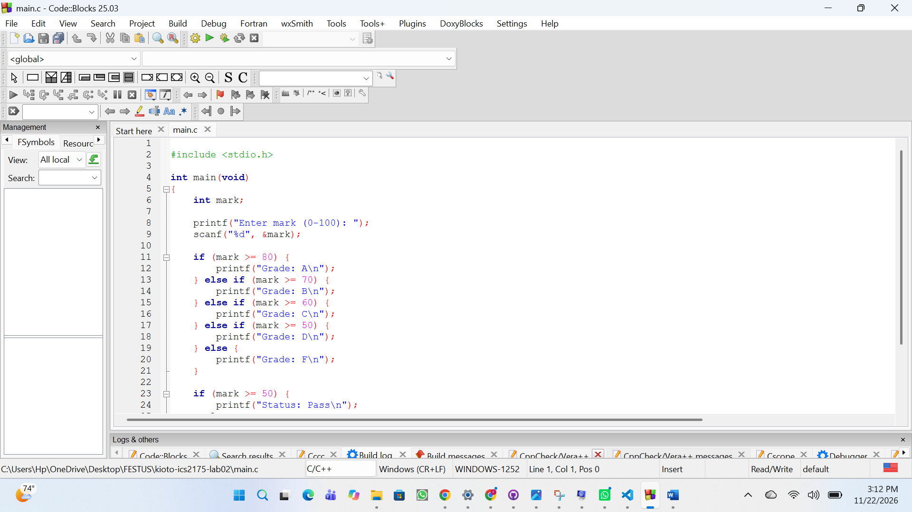
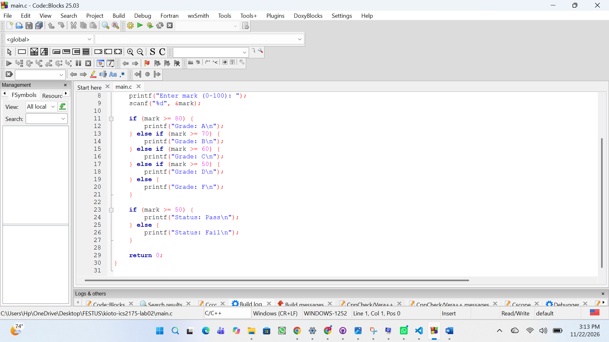

# LABORATORY 02 REPORT

## SELECTION AND DECISION-MAKING

**Course Unit:** ICS 2175 – Introduction to Computer Programming

**Student Name:** Festus Maina

**Registration Number:** ENB211-0003/2025

**Programme:** Bachelor of Science in Agriculture and Biosystems Engineering

**Laboratory Number:** Laboratory 02

**Laboratory Title:** Selection and Decision-Making

**Date:** 22 November 2026

**GitHub Username:** Chaos-Walker

**Submission Type:** Individual Practical Report

**Institution:** JKUAT


## 2. OBJECTIVE

The main objective of this laboratory practical was to understand and implement selection and decision-making structures in the C programming language.

The specific objectives were:

1. To understand and apply relational and logical operators when creating conditions.
2. To implement `if`, `if-else` and `else-if` statements to classify student marks into different grades.
3. To use `switch` statements to display messages based on the assigned grade.
4. To implement input validation to handle invalid entries and marks outside the permitted range of 0 to 100.
5. To test the programs using different input values, including boundary cases.
6. To gain practical experience using Git and GitHub to manage source code, create branches, commit changes and submit work through a pull request.


## 3. ENVIRONMENT AND SETUP

### 3.1 Development Environment

The laboratory practical was carried out using a computer running Windows 11 operating system. Code::Blocks version 25.03 was used as the Integrated Development Environment (IDE) for writing, editing, compiling and executing C programs.

The MinGW GCC compiler was used to compile the C source code.

The following tools and technologies were used during the practical:

| Component | Description |
|---|---|
| Operating System | Windows 11 |
| Integrated Development Environment | Code::Blocks 25.03 |
| Compiler | MinGW GCC |
| Programming Language | C |
| Version Control System | Git |
| Online Repository Hosting | GitHub |
| Git Interface | GitHub Desktop |

### 3.2 Software Configuration

Code::Blocks 25.03 provided the programming environment used to develop the laboratory programs. The MinGW GCC compiler was used to translate the written C source code into executable programs.

The original selection program was saved as `main.c`, while the improved version was saved separately as `improve.c`, following the lecturer's additional instructions.

### 3.3 Project Setup and Compilation

The Laboratory 02 project was organised using the official Kiotolabs GitHub starter repository. The source files and screenshots were maintained within the repository structure.

After writing the programs, I saved the source files and used the Build function in Code::Blocks to compile them. I then executed the programs to verify the grading conditions, pass/fail classification and input validation.

GitHub Desktop was used to manage the project repository, create an individual working branch, commit changes and push the completed work to my personal GitHub fork.

### 3.4 Development Tools

The combination of Code::Blocks and MinGW GCC provided the tools needed to write and test C programs. Git and GitHub Desktop helped manage changes to the source code and maintain a record of the practical work before submission through a pull request.


## 4. EXERCISE — SELECTION AND DECISION-MAKING

### 4.1 Introduction

The practical exercise involved developing C programs that use selection and decision-making statements to classify student marks into grades and determine pass or fail status.

The grading system used a scale ranging from 0 to 100, where marks of 80–100 received grade A, 70–79 received grade B, 60–69 received grade C, 50–59 received grade D, and marks below 50 received grade F.

Two source files were implemented. The first program, `main.c`, used if-else statements to determine the grade and pass/fail status. The second program, `improve.c`, introduced additional input validation and a switch statement to display descriptive messages based on the assigned grade.


### 4.2 Original Source Code — main.c

```c
#include <stdio.h>

int main(void)
{
    int mark;

    printf("Enter mark (0-100): ");
    scanf("%d", &mark);

    if (mark >= 80) {
        printf("Grade: A\n");
    } else if (mark >= 70) {
        printf("Grade: B\n");
    } else if (mark >= 60) {
        printf("Grade: C\n");
    } else if (mark >= 50) {
        printf("Grade: D\n");
    } else {
        printf("Grade: F\n");
    }

    if (mark >= 50) {
        printf("Status: Pass\n");
    } else {
        printf("Status: Fail\n");
    }

    return 0;
}
```

### 4.3 Explanation of the Original Program

The program begins by including the standard input/output library using `#include <stdio.h>`, which allows the use of functions such as `printf()` and `scanf()`.

The variable `mark` is declared as an integer to store the student's entered mark.

The `printf()` function displays a prompt requesting the user to enter a mark, while `scanf()` reads and stores the entered value.

An `if-else-if` ladder is used to classify the mark into the appropriate grade:

- Marks greater than or equal to 80 receive grade A.
- Marks greater than or equal to 70 receive grade B.
- Marks greater than or equal to 60 receive grade C.
- Marks greater than or equal to 50 receive grade D.
- Marks below 50 receive grade F.

A second `if-else` statement determines the student's performance status. A mark of 50 or above produces a Pass status, while a mark below 50 produces a Fail status.

Finally, `return 0` indicates that the program has completed successfully.

### 4.4 Improved Program — improve.c

Following the lecturer's additional instructions, a second source file named `improve.c` was created without deleting or replacing the original `main.c` file.

The improved program introduced input validation using `scanf()` return-value checking and relational and logical operators. It also used a `switch` statement to display descriptive messages for each grade.


```c
#include <stdio.h>

int main(void)
{
    int mark;
    char grade;

    printf("Enter mark (0-100): ");

    if (scanf("%d", &mark) != 1) {
        printf("Invalid input!\n");
        return 1;
    }

    if (mark < 0 || mark > 100) {
        printf("Invalid mark! Enter 0-100.\n");
        return 1;
    }

    if (mark >= 80) {
        grade = 'A';
    } else if (mark >= 70) {
        grade = 'B';
    } else if (mark >= 60) {
        grade = 'C';
    } else if (mark >= 50) {
        grade = 'D';
    } else {
        grade = 'F';
    }

    printf("Grade: %c\n", grade);

    switch (grade) {
        case 'A':
            printf("Excellent\n");
            break;
        case 'B':
            printf("Very Good\n");
            break;
        case 'C':
            printf("Good\n");
            break;
        case 'D':
            printf("Pass\n");
            break;
        case 'F':
            printf("Fail\n");
            break;
    }

    if (mark >= 50) {
        printf("Status: Pass\n");
    } else {
        printf("Status: Fail\n");
    }

    return 0;
}
```

### 4.6 Explanation of the Improved Program

The improved program builds on the original grading program by introducing input validation and a `switch` statement.

**a) Variable declaration**

Two variables are declared:

- `mark` stores the integer entered by the user.
- `grade` stores the character representing the assigned grade.

**b) Input validation**

The statement `scanf("%d", &mark) != 1` checks whether the user entered a valid integer. If the input is not an integer, the program displays an invalid input message and terminates.

**c) Relational and logical operators**

The condition `mark < 0 || mark > 100` checks whether the entered mark is outside the permitted range. The logical OR operator (`||`) ensures that either condition is sufficient to identify an invalid mark.

**d) If-else-if ladder**

The program uses an if-else-if structure to assign the appropriate grade according to the grading scale. The assigned grade is stored in the `grade` variable.

**e) Switch statement**

The `switch` statement checks the value stored in `grade` and displays a descriptive message:

- A displays Excellent.
- B displays Very Good.
- C displays Good.
- D displays Pass.
- F displays Fail.

The `break` statements prevent execution from continuing into the next case.

**f) Pass/fail classification**

A final if-else statement checks whether the mark is at least 50. Marks of 50 and above are classified as Pass, while marks below 50 are classified as Fail.

### 4.7 Program Output

The following examples illustrate the expected output of the improved program for different marks.

**Test case 1: Mark of 85**

```text
Enter mark (0-100): 85
Grade: A
Excellent
Status: Pass
```

**Test case 2: Mark of 72**

```text
Enter mark (0-100): 72
Grade: B
Very Good
Status: Pass
```

**Test case 3: Mark of 40**

```text
Enter mark (0-100): 40
Grade: F
Fail
Status: Fail
```

**Test case 4: Invalid mark of 105**

```text
Enter mark (0-100): 105
Invalid mark! Enter 0-100.
```

**Test case 5: Non-numeric input**

```text
Enter mark (0-100): abc
Invalid input!
```

These examples demonstrate how the program handles different grading ranges, pass/fail classification and invalid input.


### 4.8 Comparison Between the Original and Improved Programs

The original program and the improved program both perform student grade classification. However, the improved program includes additional features to make it more reliable and easier to understand.

| Feature | Original Program (`main.c`) | Improved Program (`improve.c`) |
|---|---|---|
| Grade classification | Uses `if-else-if` statements | Uses `if-else-if` statements |
| Pass/Fail decision | Uses `if-else` statements | Uses `if-else` statements |
| Grade descriptions | Basic grade output | Uses a `switch` statement |
| Input validation | Does not check the validity of user input | Checks whether `scanf()` successfully reads an integer |
| Mark range validation | Does not reject marks outside the valid range | Accepts marks from 0 to 100 only |
| Error handling | Limited input checking | Displays messages for invalid input |

The improved program is more reliable because it validates user input before processing the mark. It also uses a `switch` statement to display grade descriptions, making the program more structured.

Therefore, the improved version builds on the original program by introducing better input validation and clearer output while maintaining the required grading logic.

### 4.9 Evidence and Screenshots

The screenshots below provide evidence of the source code, program execution, and testing carried out during Laboratory 02. They demonstrate the implementation of selection and decision-making statements in C.

**Figure 1: Original source code (`main.c`)**

This screenshot shows the original C program containing the `if`, `else if`, and `else` statements used to determine a student's grade and pass or fail status.



**Figure 2: Improved source code (`improve.c`)**

This screenshot shows the improved program, which includes input validation, grade classification using an `if-else-if` ladder, and a `switch` statement for displaying grade descriptions.



**Figure 3: Program execution and grade testing**

The following screenshots show the program being tested with different marks to verify that it assigns the correct grades and displays the appropriate results.

- `test-mark=85.png` – tests a mark in the A grade range.
- `test-mark=72.png` – tests a mark in the B grade range.
- `test-mark=40.png` – tests a mark in the F grade range.

**Figure 4: Boundary and invalid input testing**

These screenshots provide evidence of testing marks at important grading boundaries and checking how the program handles an invalid negative mark.

- `test-mark=0.png` – tests the minimum valid mark.
- `test-mark=50.png` – tests the D grade boundary.
- `test-mark=80.png` – tests the A grade boundary.
- `test-mark=100.png` – tests the maximum valid mark.
- `test-mark=-5.png` – tests an invalid negative mark.

**Summary**

The screenshots provide practical evidence of the implementation and testing of both the original and improved C programs. They also demonstrate the use of different test values to check grade classification, pass/fail decisions, and input validation.


## 5. Testing and Troubleshooting

### 5.1 Testing

The original and improved C programs were tested using different input values to verify the accuracy of the grading system and the correct operation of the decision-making statements.

The following test cases were used:

| Test Case | Input Mark | Expected Grade | Expected Result |
|---|---:|---|---|
| 1 | 85 | A | Pass |
| 2 | 72 | B | Pass |
| 3 | 40 | F | Fail |
| 4 | 50 | D | Pass |
| 5 | 80 | A | Pass |
| 6 | 0 | F | Fail |
| 7 | 100 | A | Pass |
| 8 | -5 | Invalid | Invalid mark message |

The tests covered normal marks, grading boundaries, the minimum and maximum valid marks, and an invalid negative mark.

### 5.2 Troubleshooting

During the improvement of the original program, input validation was added to make the program more reliable.

The improved program checks whether the entered mark is within the valid range of 0 to 100. The condition:

`mark < 0 || mark > 100`

is used to detect marks outside the accepted range. If an invalid mark is entered, the program displays an error message instead of assigning an incorrect grade.

Input validation was also added using the return value of `scanf()` to check whether the user entered a valid number.

### 5.3 Testing Results

The program correctly applies the grading conditions to the tested marks. The `if-else-if` structure determines the grade, while the `switch` statement displays the corresponding grade description.

The tests demonstrate that the improved program handles valid marks, grading boundaries, and invalid negative values appropriately.


## 6. Git and GitHub Workflow

### 6.1 Forking the Repository

The official Laboratory 02 repository was forked to my personal GitHub account to create an independent copy where I could complete the practical exercises.

- **Original repository:** https://github.com/Kiotolabs/kioto-ics2175-lab02
- **My GitHub account:** https://github.com/Chaos-Walker
- **My forked repository:** https://github.com/Chaos-Walker/kioto-ics2175-lab02

### 6.2 Cloning the Repository

After forking, I cloned my personal repository to my local computer so that I could work on the files using Code::Blocks and Git.

### 6.3 Creating a Working Branch

A separate branch was created following the required naming convention:

`student/ENB211-0003/2025/lab02`

This allowed me to make changes without directly modifying the main branch.

### 6.4 Committing and Pushing Changes

I saved my work using meaningful Git commits and pushed the completed branch to my forked GitHub repository.

The repository contains the original and improved C source files, together with the report and supporting screenshots.

### 6.5 Creating the Pull Request

After pushing the changes, I created a pull request from my working branch to the official repository's main branch for review.

- **Pull request:** https://github.com/Kiotolabs/kioto-ics2175-lab02/pull/27
- **Source branch:** `Chaos-Walker:student/ENB211-0003/2025/lab02`
- **Target repository:** `Kiotolabs/kioto-ics2175-lab02`
- **Target branch:** `main`
- **Pull request status:** Open

The pull request was left open for review and was not merged.

### 6.6 Evidence of GitHub Workflow

Screenshots were captured to document the repository forking process, branch creation, and pull request submission.

The pull request link provides access to the submitted work and its commit history.


## 7. Reflection and Lessons Learnt

Through this laboratory exercise, I gained practical experience in using selection and decision-making statements in the C programming language.

I learned how to use `if`, `if-else`, and `if-else-if` statements to make decisions based on user input. I also gained experience using the `switch` statement to display different grade descriptions depending on the assigned grade.

The exercise helped me understand the importance of input validation. By improving the original program, I learned how to check whether user input is valid and ensure that marks remain within the accepted range of 0 to 100.

I also improved my understanding of testing programs using different input values, including boundary values and invalid inputs. This helped me appreciate the importance of testing to identify errors and improve program reliability.

In addition, I gained practical experience using Git and GitHub. I learned how to fork a repository, clone it, create a working branch, commit changes, push updates, and submit a pull request.

Overall, the laboratory improved my programming, problem-solving, debugging, and version-control skills.